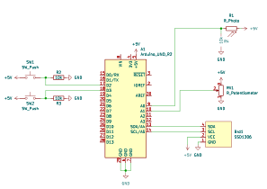

# Lightmeter
A very simple light meter using a photo resistor and Arduino Uno. Inspired by 
[Photon](https://github.com/veebch/photon).

## Setup
Clone project:
```
git clone --recurse-submodules git@github.com:daniel-seiler/Lightmeter.git
```
Install the toolchain with [arduino-cli](https://arduino.github.io/arduino-cli/) (an Arduino IDE
installation is not required):
```
arduino-cli core install arduino:avr
arduino-cli lib install "Adafruit GFX Library" "Adafruit SSD1306" "Adafruit BusIO"
```
Python with Pillow is needed to generate the bitmap sources from `res/`.

## Build
```
cmake --preset uno
cmake --build --preset uno
cmake --build --preset upload -- SERIAL_PORT=/dev/ttyACM0
```

## Usage
The dial sets one of aperture and shutter time; the other one follows the measured light.
* Button 1 switches between setting the aperture (f) and the time (T). The underline shows
  which one the dial controls.
* Button 2 holds the current measurement, press again to release.
* Hold both buttons to set the ISO value with the dial.

After switching, the dial first has to be turned to the stored value before it takes over.
The arrows blink in the direction to turn.

## Schematic

